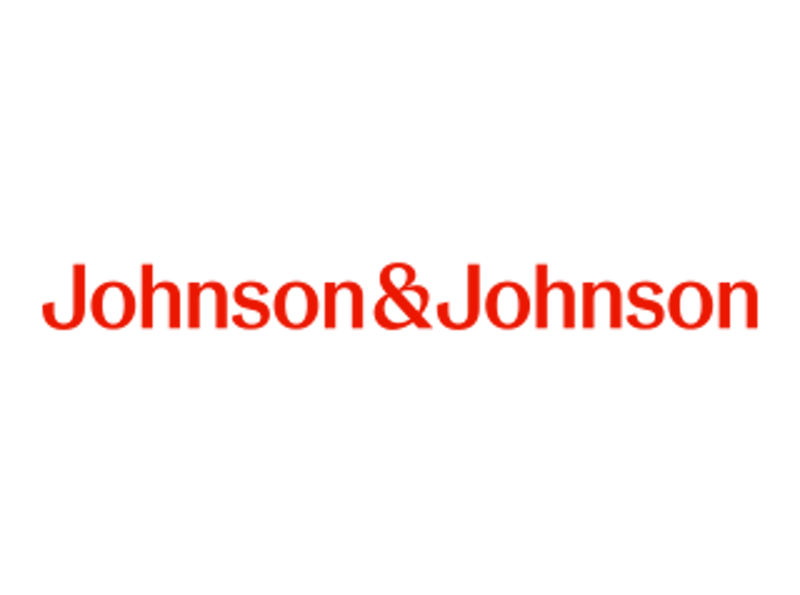
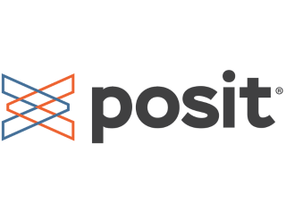
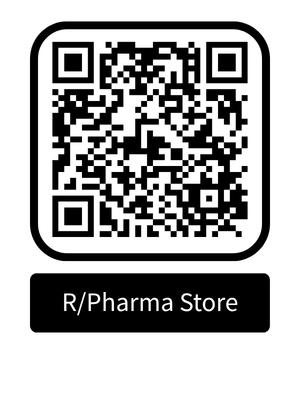
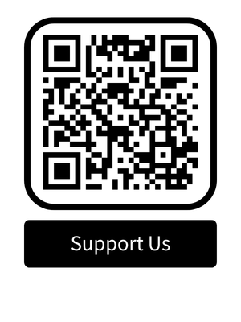
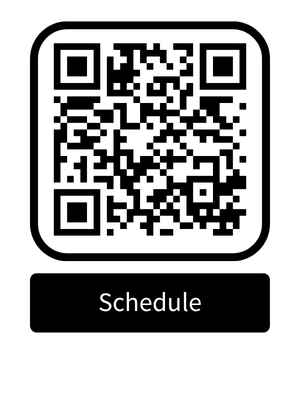
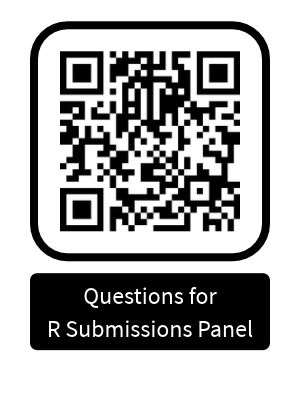

## Welcome to R/Pharma 2026

<lord-icon
    src="https://cdn.lordicon.com/lupuorrc.json"
    trigger="loop"
    style="width:500px;height:500px">
</lord-icon>

::: footer
R/Pharma 2026  -  <a href="https://lordicon.com/">Icons by Lordicon.com</a>
:::

## Housekeeping

::: {.smaller}
-  General Guidelines
    -  Terms and conditions - check the website at [https://rinpharma.com/terms.html](https://rinpharma.com/terms.html)
    -  R/Pharma is a non-commercial conference.  Vendors are welcome to attend but as practitioners, not salespeople
    -  Please be patient with us - hosting a virtual conference is different 
-  Asking for help
    -  Reach out in the **conference chat**
    -  Slack: reach out in the **#help-me** channel in rinpharmaconf slack ([**rinpharmaconf.slack.com**](rinpharmaconf.slack.com))
    -  Contact form on [**rinpharma.com**](rinpharma.com)
    -  Email to **info@rinpharma.com**
:::

## What is R/Pharma?

::: {.small}
-  Volunteer organization of passionate R practitioners in the Pharmaceutical and Biotech industries
-  This is our Annual Conference
    -  Workshops, keynotes, talks and panels
    -  Fun stuff in the breaks
    -  Started in 2018 (In person 2018, 2019.  Virtual from 2020)
-  Want to help?  Join our community
    -  **email info@rinpharma.com to contribute**
    -  keep in touch through social media

-  We've been busy in 2026...
:::

## R/Pharma 2026

::: {.incremental .small}
-  Fourth R/Pharma US summit @ posit::conf 2026 (Sep 13)
    -  90+ representatives from 40+ companies contributed to discussions on R and open source in Pharma and biotech
-  First R/Pharma European summit @ Novartis (Oct 5)
    -  Notes available on R/Pharma website
-  Third R/Pharma genAI Day (Jun 16, 950 attendees)
    - Check R/Pharma website or YouTube channel for recordings
-  Keep up to date at ([https://rinpharma.com/](https://rinpharma.com/))
:::

## R/Pharma APAC Track

::: {.small}

-  Third year running a scientific track for both EU/US and APAC.
-  Almost 24 hours of R/Pharma!!!
-  Daniel Sabanés Bové and APAC organizing committee managing APAC track
    -  keynotes, plus Europe/US keynote replay followed by discussion panels
    -  presentations
    -  workshops
-  Presentations from both APAC and Europe/US will be available in our YouTube channel after R/Pharma

:::

## R/Pharma Workshop Presenters

24 Free Workshops + 1 hackathon at R/Pharma 

:::: {.columns .small}

::: {.column width="33%"}
Michael Chow  
Jeff Dickinson  
Marcin Dubel  
Matt Fidler  
Rammprasad Ganapathy  
Edward Gillian  
Garrett Grolemund  
Yi Guo  
Michelle Harwood  
Sam Hume
:::

::: {.column width="33%"}
Rich Iannone  
Mutaz M. Jaber  
Jagadish Katam  
Anne Keuneke  
Max Kuhn  
Daniel Lee  
Hana Lee  
Kevin Lee  
Kuenhung Lin  
Shannon Pileggi
:::

::: {.column width="33%"}
Nicola Rennie  
Bruno Rodrigues  
Daniel Sabanés Bové  
Daniel Sjoberg  
Brian Varney  
Isabella Velásquez  
Adrian Waddell  
Justin Wilkins  
Eric Zhang  
Yilong Zhang  
Joe Zhu
:::

::::

## Brian Bole Award of Excellence

::: {.incremental .small}
-  Brian Bole was an innovator and thought leader in the healthcare and life sciences space, working with R and an early adopter of shiny
-  The Brian Bole Award of Excellence is presented annually in recognition of outstanding achievements in open source life sciences
-  Brian Bole Award has previously been awarded to:
    -  {admiral} development team
    -  Novo Nordisk submissions team
    -  R Consortium Submissions Working Group
    -  {gtsummary} development team
-  This year we're proud to present it to Matt Fidler and everyone who has worked on {nlmixr2} for their contributions to the open source space.
:::

## Thank You to R/Pharma Sponsors!

{width=300}
{width=300}

## Supporting and Celebrating R/Pharma

::: {.small}
-  Online merchandise store
    - [https://www.bonfire.com/store/open-source-in-pharma/](https://www.bonfire.com/store/open-source-in-pharma/)
-  Support our non-profit
    - [https://www.pledge.to/r-pharma](https://www.pledge.to/r-pharma)
-  #rinpharma in social media (LinkedIn, X, Mastodon, Bluesky, YouTube)
:::

:::{.space-image}
{width=200px}
{width=200px}
:::

## R/Pharma 2026 Virtual

::: {.small}
-  Before/after R/Pharma and during breaks
    -  Network and visit Expo
        -  Expo features booths from R/Pharma workshops (recordings to follow)
        -  Coffee and chat 30 minutes before opening on each day
-  Schedule: [https://rpharma-2026.sessionize.com/](https://rpharma-2026.sessionize.com/)
-  Wednesday - check schedule for pre-recorded talks
:::

:::{.space-image}
{width=200px}
:::

## SPECIAL ANNOUNCEMENT

::: {.small}
-  Today: R Submissions panel (2:05PM EDT)
    - R/Consortium: Ning Leng, Eric Nantz
    - FDA: Paul Schuette, Hye Soo Cho, YouKyeon Chang
    - Posit: Joe Cheng
- QR Code to slido below to submit questions
- **This will not be recorded**
:::

:::{.space-image}
{width=200px}
:::

